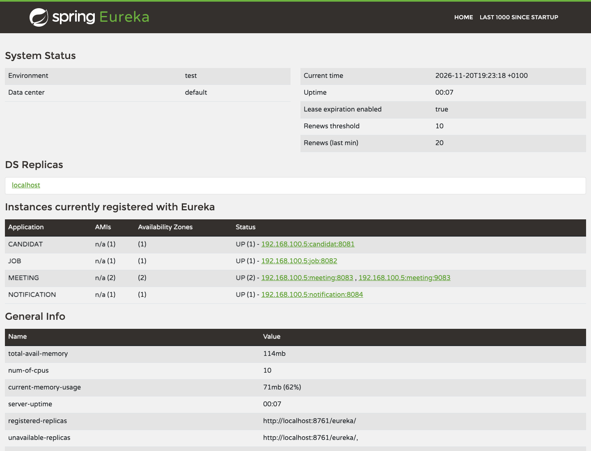
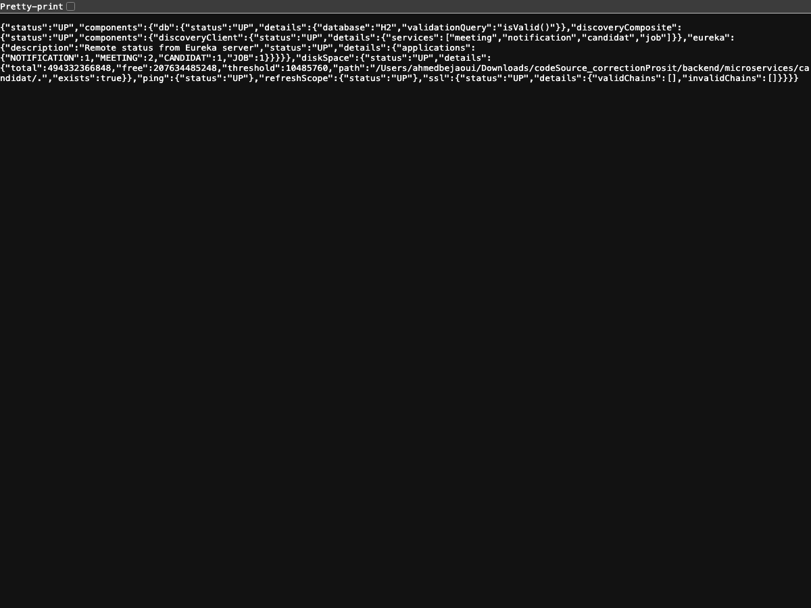
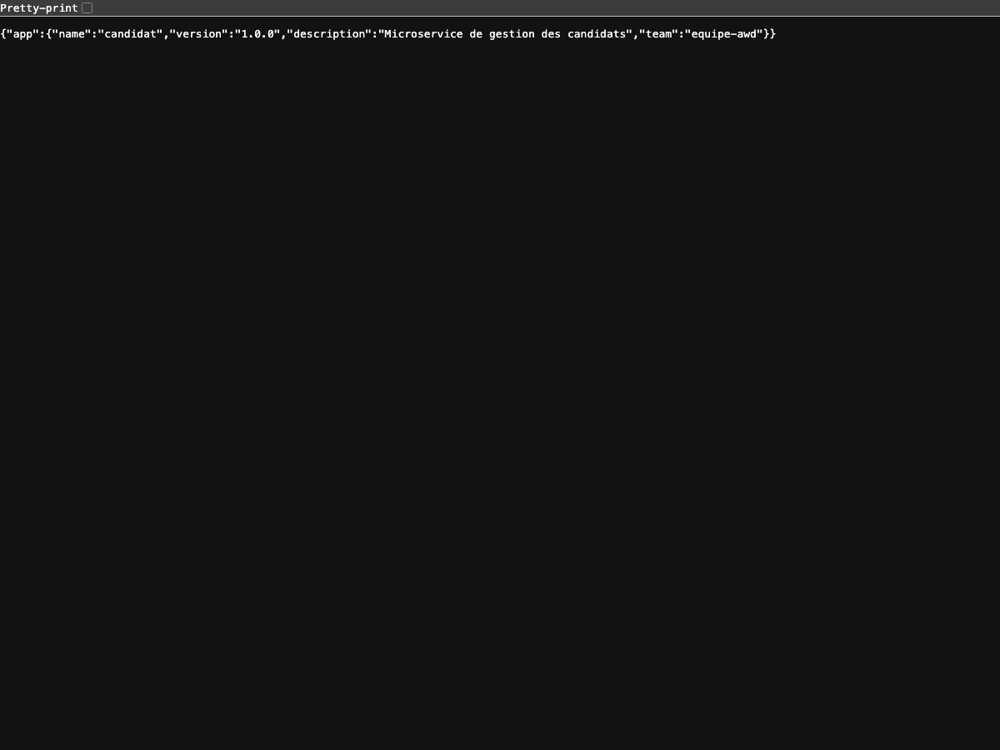
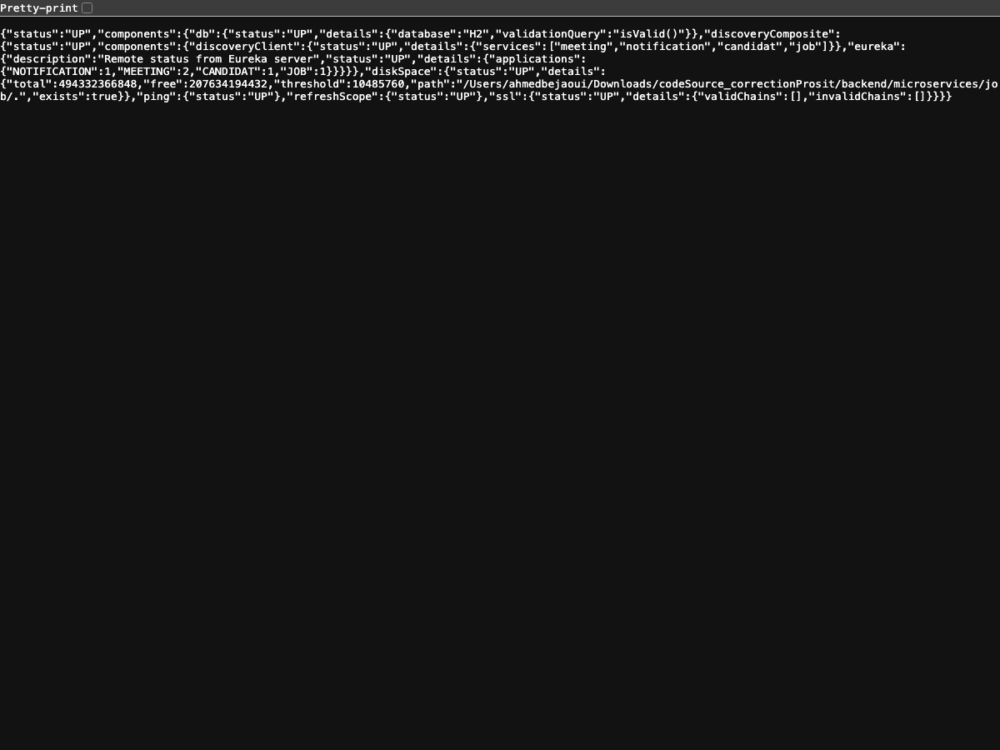
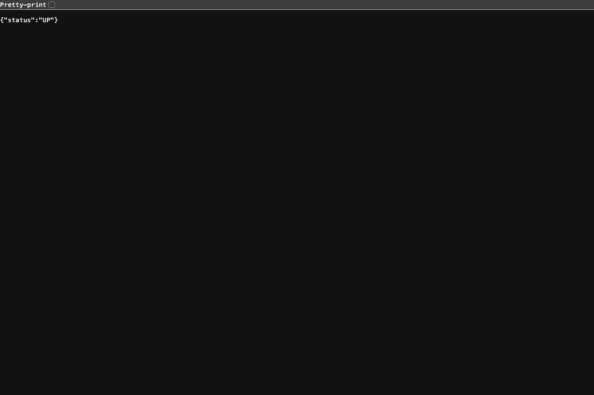
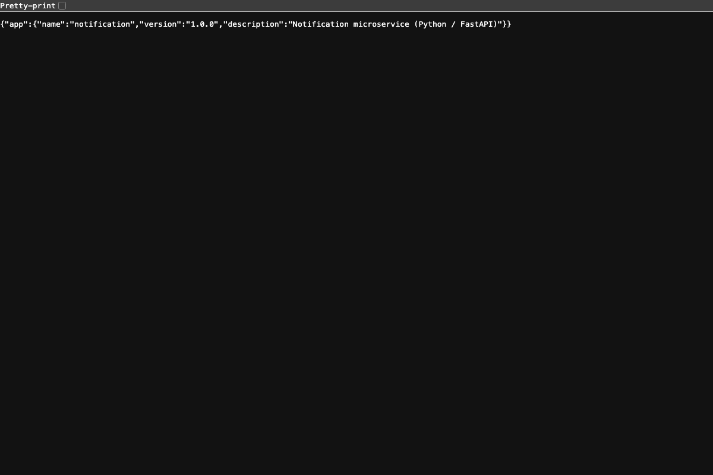

# AWD — Eureka & Observabilité (Actuator)

Projet Architecture Web Distribuée : découverte de services avec Netflix Eureka et observabilité avec Spring Boot Actuator.

## Membres de l'équipe

- Ahmed Bejaoui

## Microservices

| Service | Technologie | Port | Nom Eureka |
|---|---|---|---|
| Eureka Server | Spring Boot | 8761 | — |
| Candidat | Spring Boot + H2 | 8081 | CANDIDAT |
| Job | Spring Boot + H2/MySQL | 8082 | JOB |
| Meeting | Node.js / Express | 8083 | MEETING |
| Notification | Python / FastAPI | 8084 | NOTIFICATION |

## Démarrage

1. Eureka (`backend/microservices/eureka`) — Java 17 : `mvn spring-boot:run`
2. Candidat — `mvn spring-boot:run` (port 8081)
3. Job — `mvn spring-boot:run` (port 8082)
4. Meeting — `npm install && npm start` (port 8083)
5. Notification — `python -m venv venv && source venv/bin/activate && pip install -r requirements.txt && uvicorn app.main:app --port 8084`

Deuxième instance Meeting (rendu) :

```bash
cd backend/microservices/meeting
PORT=9083 npm start
```

## Captures d'écran (rendu)

### Dashboard Eureka

Les quatre services sont enregistrés. **MEETING** tourne avec **2 instances** (8083 et 9083).



### Actuator — Candidat

`/actuator/health` et `/actuator/info` :





### Actuator — Job



### Health / Info — Meeting & Notification





## URLs utiles

- Eureka : http://localhost:8761
- Candidat health : http://localhost:8081/actuator/health
- Job health : http://localhost:8082/actuator/health
- Meeting health : http://localhost:8083/health
- Notification info : http://localhost:8084/info
